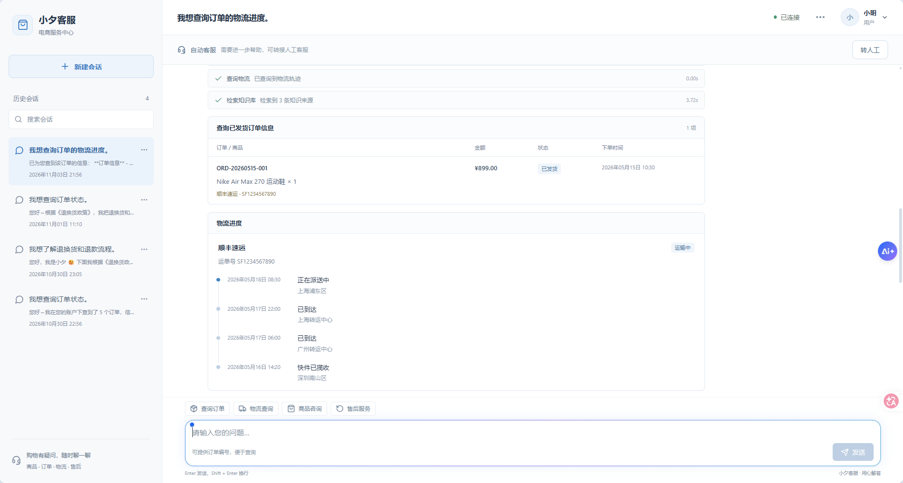
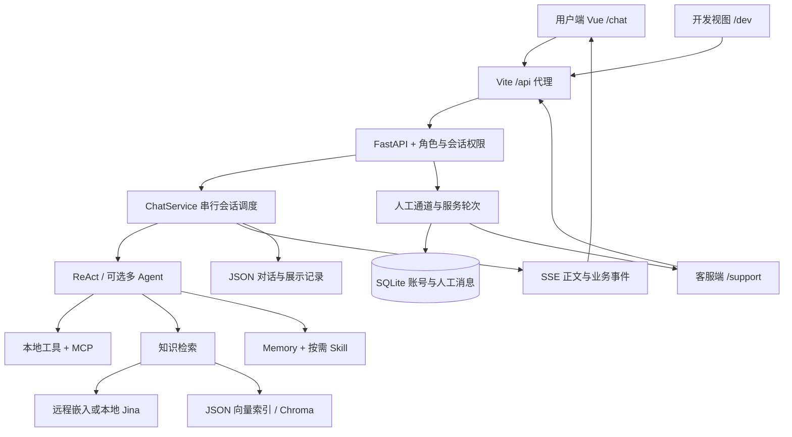

# 小夕客服 · E-commerce Service Agent

**把 Agent 对话、业务工具和人工接待连接起来的电商客服全栈演示项目。**

[简体中文](README.md) · [English](README.en.md)

<p align="center">
  <a href="#highlights">项目亮点</a> ·
  <a href="#demo">实际界面</a> ·
  <a href="#architecture">架构设计</a> ·
  <a href="#quick-start">快速开始</a> ·
  <a href="#validation">验证与边界</a> ·
  <a href="#documentation">文档</a>
</p>



> 截图由项目维护者提供，展示实际运行中的订单查询、物流轨迹和知识检索界面。订单与物流使用内置模拟业务数据，业务日期为 2026 年 5 月；侧栏显示实际会话时间。截图仅用于界面展示，不构成模型效果评测。README 提供中英文版本，当前应用界面为中文。

<a id="highlights"></a>
## 项目亮点

客服系统不仅需要“能回答”，还需要处理工具执行、结果展示、账号权限，以及自动客服和人工客服之间的接续。本项目将电商客服 Agent、Web API、用户界面和人工服务工作台集成到同一套应用中。

| 能力 | 实现方式 | 解决的问题 |
| --- | --- | --- |
| Agent 工具执行 | ReAct / Function Calling，统一接入本地和 MCP 工具 | 订单、物流、商品、售后等操作可被编排 |
| 知识检索 | Markdown 分块，独立嵌入配置，JSON 向量或 Chroma 后端 | 从政策、FAQ、配送说明中召回依据 |
| 真实流式交互 | SSE 正文增量、工具状态、业务结果事件 | 将用户回复与调试详情分离 |
| 账号与权限 | user / support / dev 角色、会话归属校验、邀请注册 | 用户会话隔离，客服与开发功能分别授权 |
| 人工接待闭环 | 用户唯一人工通道、独立服务轮次、版本检查和历史归档 | 自动客服与人工服务之间可切换、可恢复 |
| Memory 与 Skill | 用户记忆绑定、短/长期记忆、按需加载 SKILL.md | 复用业务流程并保持用户上下文 |
| 本地工程化 | 前后端代理、一键启停、进程身份核实、健康检查 | 多服务可以在本机统一管理 |

<a id="demo"></a>
## 演示路径

1. 启动服务，注册一个用户账号，进入 `/chat`。
2. 从内置 Mock 数据中选择订单，提问物流、商品或售后问题。
3. 查看流式回复、工具执行状态、业务结果和会话历史。
4. 使用独立浏览器会话注册客服账号，在 `/support` 接待人工咨询。
5. 结束人工服务，确认自动客服恢复、历史记录仍可查看。

角色入口：用户 `/chat`、客服 `/support`、开发人员 `/dev`。客服和开发人员注册需要本机生成的邀请码，不提供公共默认密码。

<a id="architecture"></a>
## 架构设计



- **Agent 核心**负责工具调用、知识检索、记忆和结构化结果；Web 层负责会话与呈现。
- **嵌入配置独立**：不同服务地址不会默认复用聊天密钥；本机 Jina 服务支持 query/passage 任务区分。
- **自动回复使用 SSE**；人工消息采用短轮询，分别服务于不同的交互流程。
- **ChatService 的锁是当前约束的一部分**：原有工具注册存在进程级引用，不能直接去掉锁来获得安全并发。

| 层次 | 技术 |
| --- | --- |
| 前端 | Vue 3、TypeScript、Vite、Pinia、Element Plus |
| 后端 | Python、FastAPI、Pydantic、Uvicorn |
| Agent | OpenAI 兼容接口、ReAct、Function Calling、MCP |
| 检索 | 可配置 Embeddings、离线 Jina 适配、JSON 向量或 Chroma |
| 持久化 | SQLite 账号/人工服务，JSON 对话/记忆 |
| 交互与安全 | SSE、Markdown-it、DOMPurify、HttpOnly Cookie、scrypt |

## 项目结构

```text
ecom-service-agent/
├── app/
│   ├── agent/               ReAct、记忆、Skill 加载
│   ├── api/                 Web API 与会话服务
│   ├── portal/              账号、权限和人工接待
│   ├── streaming/           SSE、业务结果与调试边界
│   ├── rag/                 嵌入配置、检索、向量后端
│   ├── tools/               Mock 电商工具与统一注册
│   ├── knowledge/           可重建索引的政策与 FAQ 源文档
│   ├── skills/              可复用业务技能
│   └── evaluation/          测试样例、沙箱和评估指标
├── frontend/                Vue + TypeScript，含 package-lock.json
├── mcp_server/              独立 MCP 工具服务
├── scripts/                 Web 启动器和服务管理
├── tests/                   隔离回归测试与显式调用的演示脚本
├── docs/                    项目截图和发布说明
├── 启动项目.cmd
└── 停止项目.cmd
```

<a id="quick-start"></a>
## 快速开始

### 1. 安装依赖并配置模型

需要 Python 3.11+、Node.js 22，以及可用的 OpenAI 兼容聊天与嵌入服务。按以下命令准备本地运行环境。

```powershell
git clone https://github.com/Auroral666/ecom-service-agent.git
cd ecom-service-agent
py -3.11 -m venv .venv
.\.venv\Scripts\python.exe -m pip install -r requirements.txt
Copy-Item .env.example .env
Push-Location frontend
npm ci
Pop-Location
```

在 `.env` 中填写自己的 `OPENAI_API_KEY`，确认 `OPENAI_BASE_URL`、`MODEL_NAME` 和 `EMBEDDING_MODEL`。默认示例使用远程嵌入；不同嵌入服务需设置独立的 `EMBEDDING_BASE_URL` 和 `EMBEDDING_API_KEY`。

### 2. 构建知识库索引

```powershell
.\.venv\Scripts\python.exe -B -X utf8 -m app.scripts.build_kb_index
```

该命令读取 `app/knowledge/`，调用配置的嵌入服务，并把索引写入本机 `app/sessions/`。更换嵌入模型或更新文档后需要重建；使用远程服务可能产生费用。

若使用本地 Jina，先按 [本地嵌入说明](app/rag/LOCAL_EMBEDDING.md) 准备完整模型缓存并启动服务，再构建索引。它只负责向量化，不会替代聊天模型。

### 3. 启动前后端

```powershell
$env:ECOM_PYTHON = (Resolve-Path .\.venv\Scripts\python.exe).Path
# 可选：若 Node.js 不在 PATH，设置 ECOM_NODE 为 node.exe 完整路径。
.\启动项目.cmd
```

| 地址 | 用途 |
| --- | --- |
| http://127.0.0.1:5173 | 前端入口 |
| http://127.0.0.1:18080/docs | API 文档 |
| http://127.0.0.1:18080/api/health | 后端健康检查 |
| http://127.0.0.1:18181/health | 本地 Jina 健康检查，仅配置启用时 |

```powershell
.\停止项目.cmd
```

关闭启动窗口不会停止后台服务。进程记录和日志位于 `.runtime/`；完整说明见 [启动停止说明](启动停止说明.md)。新终端需重新设置环境变量，或将其设置为用户环境变量。

### 4. 首次账号使用

用户可以直接注册。客服和 dev 的邀请码由本机首次启动生成在 `app/sessions/web/.portal/invitations.json`；由项目负责人私下提供，不上传到仓库。演示不同角色时使用不同浏览器或独立隐私窗口，避免共享登录 Cookie。

<a id="validation"></a>
## 验证与实现边界

运行不调用真实模型的 Web/权限/流式/嵌入配置回归：

```powershell
.\.venv\Scripts\python.exe -m pip install -r tests/requirements.txt
.\.venv\Scripts\python.exe -B -X utf8 -m pytest -q tests/test_portal.py tests/test_web_api.py tests/test_streaming.py tests/test_first_token.py tests/test_embedding_configuration.py
Push-Location frontend
npm run build
Pop-Location
```

其他以 `test_` 命名的历史文件中包含真实模型演示；不要把直接执行它们等同于无网络测试。评估脚本也可能调用模型，不能把 `--no-judge` 理解为完全不调用模型。

- 订单、物流和售后工具使用 **Mock 业务数据**，没有接入真实电商平台或支付系统。
- 当前服务串行调度共享工具上下文；尚未实现面向大规模并发的会话执行架构。
- Memory、Skill、MCP 和多 Agent 能力有各自配置开关，不是所有模式默认同时运行。
- 调试详情要求角色、来源与临时能力令牌检查；页面不展示模型隐藏推理原文。
- 当前版本面向本机运行与功能演示，公网部署仍需独立处理 HTTPS、配置管理、限流、审计和运维。

<a id="documentation"></a>
## 进一步阅读

- [账号与人工服务](app/portal/README.md)
- [流式输出和事件边界](app/streaming/README.md)
- [独立嵌入与本地 Jina](app/rag/LOCAL_EMBEDDING.md)
- [一键启停](启动停止说明.md)
- [上传范围与排除清单](docs/PUBLISHING.md)
- [English README](README.en.md)
