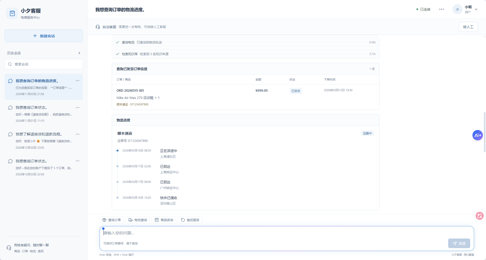
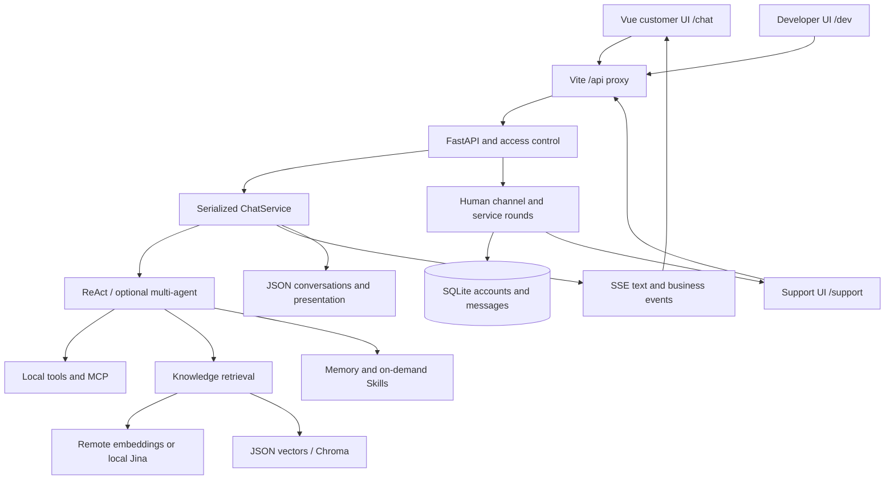

# Xiaoxi Support · E-commerce Service Agent

**A full-stack customer-service demonstration connecting Agent conversations, business tools, and human support.**

[简体中文](README.md) · [English](README.en.md)

<p align="center">
  <a href="#highlights">Highlights</a> ·
  <a href="#demo">Walkthrough</a> ·
  <a href="#architecture">Architecture</a> ·
  <a href="#quick-start">Quick start</a> ·
  <a href="#validation">Validation & limits</a> ·
  <a href="#documentation">Documentation</a>
</p>



> The maintainer supplied this screenshot of the running application, showing order queries, shipping events, and knowledge retrieval. Orders and shipping use built-in mock data dated May 2026; the sidebar shows actual conversation timestamps. The screenshot illustrates the interface and does not establish model quality. Chinese and English READMEs are available; the application UI is currently Chinese.

<a id="highlights"></a>
## Highlights

A useful support application needs more than a chatbot: it must handle tool execution, result presentation, account permissions, and continuity between automated and human service. The application integrates an e-commerce Agent, Web API, customer interface, and support workspace.

| Capability | Implementation | Purpose |
| --- | --- | --- |
| Agent tool execution | ReAct / Function Calling with local and MCP tools | Compose order, shipping, product, and after-sales operations |
| Knowledge retrieval | Markdown chunks, separate embedding configuration, JSON vectors or Chroma | Retrieve policy, FAQ, and delivery evidence |
| Streaming interaction | SSE text deltas, tool states, and business-result events | Separate customer-visible replies from debug details |
| Accounts and permissions | user / support / dev roles, session ownership, employee invitations | Isolate sessions and authorize role-specific actions |
| Human-service continuity | One channel per customer, service rounds, revision checks, archives | Transfer between automated and human service |
| Memory and Skill | User-bound memory, short/long-term facts, on-demand SKILL.md loading | Reuse workflows with the correct user context |
| Local operations | Frontend proxy, managed startup/shutdown, process checks, health probes | Operate the local services together |

<a id="demo"></a>
## Walkthrough

1. Start the application, register a customer, and open `/chat`.
2. Choose an order from the built-in mock dataset and ask about delivery, products, or returns.
3. Inspect streamed replies, tool activity, business results, and history.
4. Register a staff account in an independent browser context and accept a request in `/support`.
5. End human service and verify that automated service resumes with history preserved.

Role routes: `/chat` for customers, `/support` for staff, and `/dev` for developers. Employee registration requires locally generated invitations; there is no shared default password.

<a id="architecture"></a>
## Architecture



- The **Agent core** handles tools, knowledge, memory, and structured responses; the web layer handles sessions and presentation.
- **Embedding credentials are separate:** a different provider does not silently receive the chat key. Local Jina supports query/passage tasks.
- **Automated replies use SSE**; human messages use short polling.
- **The ChatService lock is intentional:** tool registration includes process-global references. Removing the lock would not provide safe concurrency.

| Layer | Technologies |
| --- | --- |
| Frontend | Vue 3, TypeScript, Vite, Pinia, Element Plus |
| Backend | Python, FastAPI, Pydantic, Uvicorn |
| Agent | OpenAI-compatible API, ReAct, Function Calling, MCP |
| Retrieval | Configurable embeddings, offline Jina adapter, JSON vectors or Chroma |
| Persistence | SQLite accounts/human service, JSON conversations/memory |
| Interaction and security | SSE, Markdown-it, DOMPurify, HttpOnly cookies, scrypt |

## Repository layout

```text
ecom-service-agent/
├── app/
│   ├── agent/               ReAct, memory, Skill loading
│   ├── api/                 Web API and session service
│   ├── portal/              Accounts, permissions, human support
│   ├── streaming/           SSE, business results, debug boundaries
│   ├── rag/                 Embedding configuration and retrieval
│   ├── tools/               Mock business tools and registry
│   ├── knowledge/           Rebuildable policy and FAQ sources
│   ├── skills/              Reusable business workflows
│   └── evaluation/          Cases, sandbox, metrics
├── frontend/                Vue + TypeScript with package-lock.json
├── mcp_server/              Separate MCP tool server
├── scripts/                 Web launcher and service management
├── tests/                   Isolated regressions and opt-in live demos
├── docs/                    Project screenshots and publication scope
├── 启动项目.cmd
└── 停止项目.cmd
```

<a id="quick-start"></a>
## Quick start

### 1. Install dependencies and configure providers

Use Python 3.11+, Node.js 22, and compatible chat/embedding services. Follow these commands to prepare the local runtime.

```powershell
git clone https://github.com/Auroral666/ecom-service-agent.git
cd ecom-service-agent
py -3.11 -m venv .venv
.\.venv\Scripts\python.exe -m pip install -r requirements.txt
Copy-Item .env.example .env
Push-Location frontend
npm ci
Pop-Location
```

Set your own `OPENAI_API_KEY` in `.env` and check `OPENAI_BASE_URL`, `MODEL_NAME`, and `EMBEDDING_MODEL`. The example uses remote embeddings. A separate provider requires its own `EMBEDDING_BASE_URL` and `EMBEDDING_API_KEY`.

### 2. Build the knowledge index

```powershell
.\.venv\Scripts\python.exe -B -X utf8 -m app.scripts.build_kb_index
```

This reads `app/knowledge/`, calls the configured embedding service, and writes the local index under `app/sessions/`. Rebuild after changing documents or embedding models. Remote service calls may incur charges.

For local Jina, prepare its full model cache and start the service using the [embedding guide](app/rag/LOCAL_EMBEDDING.md) before indexing. The embedding model does not replace the chat model.

### 3. Start the services

```powershell
$env:ECOM_PYTHON = (Resolve-Path .\.venv\Scripts\python.exe).Path
# Optionally set ECOM_NODE to node.exe if it is not on PATH.
.\启动项目.cmd
```

| Address | Purpose |
| --- | --- |
| http://127.0.0.1:5173 | Frontend |
| http://127.0.0.1:18080/docs | API documentation |
| http://127.0.0.1:18080/api/health | Backend health |
| http://127.0.0.1:18181/health | Local Jina health, only when enabled |

```powershell
.\停止项目.cmd
```

Closing the launcher window leaves background services running. Records and logs live under `.runtime/`. See the [launcher guide](启动停止说明.md). Set environment overrides in each new terminal or as user environment variables.

### 4. First accounts

Customers may self-register. Staff/dev invitations are generated locally in `app/sessions/web/.portal/invitations.json`; an operator provides them privately. They are excluded from Git. Use separate browsers or private contexts when demonstrating multiple roles.

<a id="validation"></a>
## Validation and limits

Run the web, access-control, streaming, and embedding-configuration regressions without live model calls:

```powershell
.\.venv\Scripts\python.exe -m pip install -r tests/requirements.txt
.\.venv\Scripts\python.exe -B -X utf8 -m pytest -q tests/test_portal.py tests/test_web_api.py tests/test_streaming.py tests/test_first_token.py tests/test_embedding_configuration.py
Push-Location frontend
npm run build
Pop-Location
```

Some historical `test_` files are live model demonstrations rather than offline unit tests. Evaluation may also invoke model services: `--no-judge` disables judging, not every model call.

- Order, shipping, and after-sales tools use **mock business data**, not a real commerce or payment platform.
- Shared tool context is serialized; a scalable concurrent execution architecture is not implemented.
- Memory, Skill, MCP, and multi-agent modes have separate configuration switches.
- Debug details require role/origin checks and temporary capability tokens. Hidden model reasoning is not exposed.
- The current version is designed for local use and feature demonstrations. Public hosting requires a separate HTTPS, configuration, rate-limiting, audit, and operations plan.

<a id="documentation"></a>
## Documentation

- [Accounts and human service](app/portal/README.md)
- [Streaming and event boundaries](app/streaming/README.md)
- [Independent embeddings and local Jina](app/rag/LOCAL_EMBEDDING.md)
- [Managed startup and shutdown](启动停止说明.md)
- [Publication scope](docs/PUBLISHING.md)
- [Chinese README](README.md)
